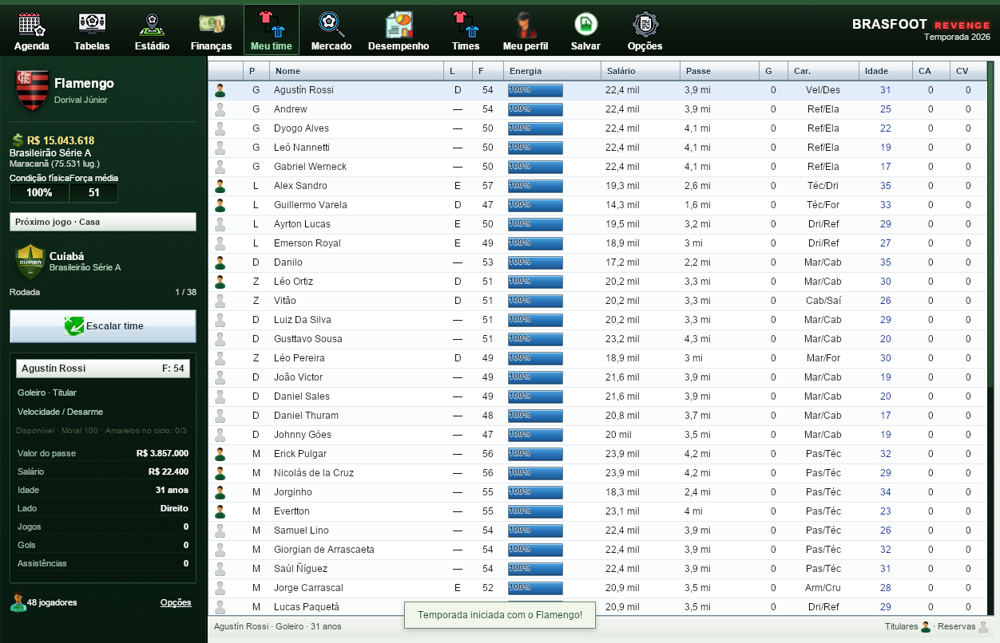
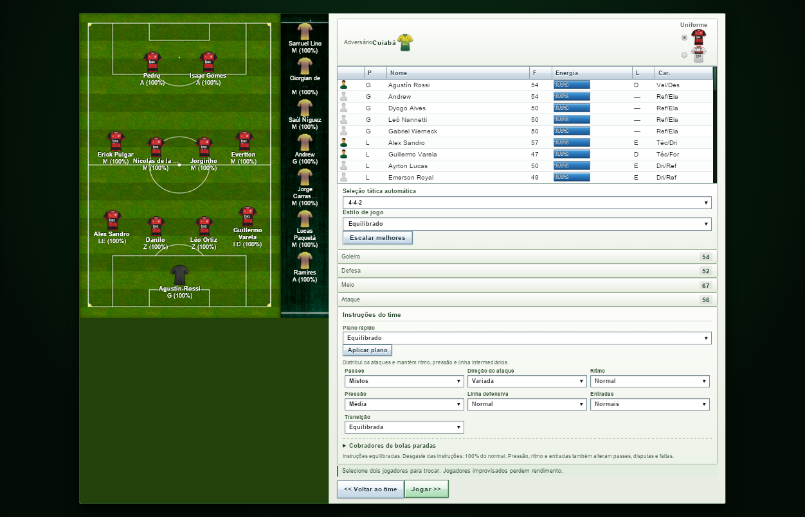
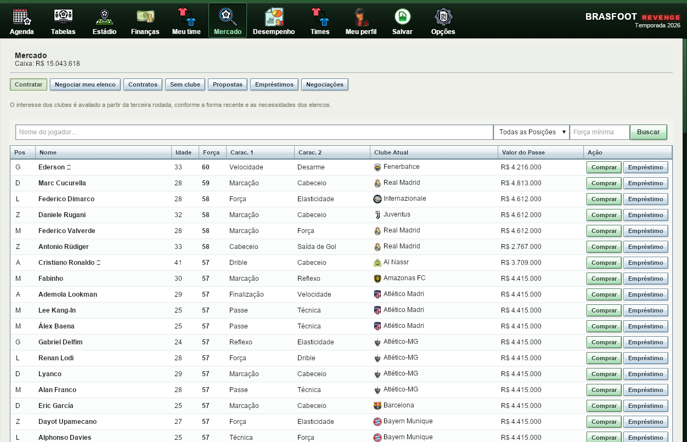
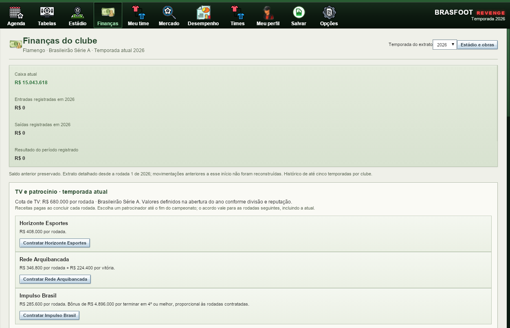
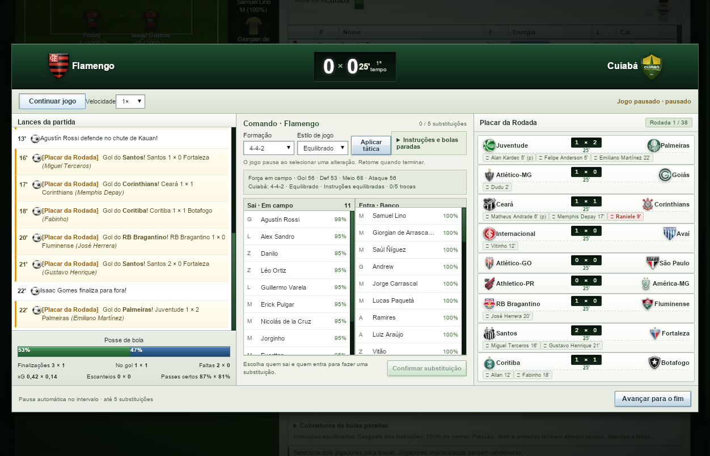

# ⚽ Brasfoot Revenge

Simulador de gestão de futebol para **Windows e Linux**, com partidas minuto a minuto, carreira, táticas, transferências e finanças. O jogo funciona offline e abre em janela própria, sem servidor local ou Java.

[](https://github.com/dznass-cmd/brasfoot-revenge/releases/tag/v1.0.1)
[](docs/OFFLINE.md)
[](docs/WINDOWS-XP.md)
[](docs/WINDOWS-XP.md#onde-editar)

**[⬇ Downloads](https://github.com/dznass-cmd/brasfoot-revenge/releases)** · **[📷 Capturas do jogo](#capturas-do-jogo)** · **[🛠 Editar e compilar](docs/WINDOWS-XP.md#onde-editar)** · [Histórico](docs/HISTORICO-ALTERACOES.md)

## O que você pode fazer

- Dirigir um clube entre **703 times disponíveis**, com escudos, uniformes e elencos locais.
- Jogar as Séries A–D, disputar temporadas consecutivas e acompanhar acesso, rebaixamento e histórico do técnico.
- Alterar escalação, formação, instruções e substituições durante as partidas.
- Negociar jogadores, renovar contratos e administrar caixa, salários, patrocínios e estádio.
- Salvar a carreira no computador e exportar/importar arquivos JSON.

## Escolha sua edição

| Edição | Como funciona | Download e informações |
| --- | --- | --- |
| **Windows 10/11 · 64 bits** | Windows Forms com WebView2 incluído na instalação offline; janela própria. | [Instalador e ZIP](https://github.com/dznass-cmd/brasfoot-revenge/releases/tag/v1.0.1) · [Guia](docs/WINDOWS.md) |
| **Linux** | Aplicativo em C com GTK4 e WebKitGTK; recursos locais. | [Pacotes Linux](https://github.com/dznass-cmd/brasfoot-revenge/releases/tag/v1.0.0) · [Modo offline](docs/OFFLINE.md) |
| **Legada · 32 bits · experimental** | Runtime próprio, sem WebView2 ou .NET; destinada ao XP SP3 e posteriores. | [ZIP legado](https://github.com/dznass-cmd/brasfoot-revenge/releases/tag/v1.1.0-legacy) · [Requisitos e testes](docs/WINDOWS-XP.md) |

**Windows XP real ainda não foi testado.** A edição legada passou no Wine e nos testes automatizados em Windows; isso não garante funcionamento em qualquer PC ou versão do Windows.

## Capturas do jogo

Capturas reais da edição legada executada no Wine, em uma carreira de demonstração. As imagens mostram a interface atual; não são capturas de Windows XP.

### Menu inicial


### Elenco e escalação

| Gestão do elenco | Campo tático e escalação |
| --- | --- |
| [](docs/prints/02-elenco.png) | [](docs/prints/03-escalacao.png) |

### Mercado e finanças

| Mercado de jogadores | Finanças do clube |
| --- | --- |
| [](docs/prints/04-mercado.png) | [](docs/prints/05-financas.png) |

### Partida ao vivo



[Clique nas imagens para ampliar](docs/prints/README.md) · [Referências e histórico da interface](docs/interface/README.md)

---

## 📦 Pacotes de Instalação e Downloads

### 🐧 Para Linux
- **Instalador Auto-executável**: `brasfoot-revenge-installer-linux.sh` (extrai e configura o atalho no menu com 1 comando: `bash brasfoot-revenge-installer-linux.sh`).
- **Pacote Debian / Ubuntu**: `brasfoot-revenge_1.0.0_amd64.deb` (instalação padrão via `sudo dpkg -i brasfoot-revenge_1.0.0_amd64.deb`).
- **Pacote Portátil Tarball**: `brasfoot-revenge-linux-x86_64.tar.gz` (descompacte e jogue em qualquer distribuição).

### 🪟 Para Windows 10/11 (64 bits)
- [Baixar o instalador ou o pacote portátil](https://github.com/dznass-cmd/brasfoot-revenge/releases/latest).
- **Instalador gráfico**: `Instalador-Brasfoot-Revenge.exe`. Instala o jogo, prepara o WebView2 e cria os atalhos.
- **Versão portátil**: `Brasfoot-Revenge-Windows-Portable.zip`. Extraia **toda** a pasta e abra `BrasfootRevenge.exe`.
- O jogo abre em uma janela própria do Windows, com Windows Forms e WebView2, sem abrir o navegador e sem servidor local.
- O pacote inclui o instalador offline oficial x64 do WebView2. Se o componente estiver ausente, a preparação é automática; aguarde na primeira abertura. Depois de baixar o pacote, a instalação e o jogo não exigem internet.
- Saves ficam em `%LOCALAPPDATA%\BrasfootRevenge\WebView2Data` e são preservados ao reinstalar ou desinstalar o jogo. Use a exportação de saves para manter uma cópia independente.
- Não distribua apenas o `.exe`: mantenha os dados, as DLLs e a pasta `prerequisites` junto dele.

[Compilação, dependências e verificação no Windows](docs/WINDOWS.md).

### Windows XP: edição legada separada

[Baixar a edição legada experimental](https://github.com/dznass-cmd/brasfoot-revenge/releases/tag/v1.1.0-legacy).

Há uma edição portátil de 32 bits destinada ao **Windows XP SP3 e posteriores**, com runtime próprio e sem WebView2 ou .NET. Ela mantém o código do jogo legível em JavaScript, HTML e CSS. O funcionamento em XP real ainda depende de validação nesse sistema; consulte os [requisitos, testes e instruções para editar e compilar](docs/WINDOWS-XP.md).


Para compilar ou gerar novos pacotes a partir do código-fonte:
```bash
# Gerar pacotes Linux:
python3 scripts/build-linux-packages.py

# Gerar pacotes Windows:
python3 scripts/build-windows.py
```

---

## 🚀 Como Jogar

### Opção 1: Pelo Executável Nativo (Recomendado)
Execute diretamente o aplicativo compilado:
```bash
cd brasfoot-revenge
./brasfoot
# ou diretamente:
./brasfoot-app
```

### Opção 2: Pelo Menu de Aplicativos do Sistema
O jogo pode ser integrado ao menu de aplicativos do Linux (GNOME / KDE / XFCE):
- Execute `./scripts/install-desktop.sh` para instalar o atalho no sistema.
- Procure por **Brasfoot Revenge** no menu iniciar e clique para abrir!
- O jogo abre em um processo separado, sem janela de terminal. Mensagens de diagnóstico ficam em `~/.local/state/brasfoot/launcher.log`.

### Opção 3: Abrindo o Arquivo Diretamente
Se preferir, você pode simplesmente dar dois cliques em `index.html` para abrir no navegador via `file://`, sem precisar de nenhum comando nem servidor web.

---

## Funcionamento offline

O executável usa apenas arquivos locais e bloqueia recursos de rede. Saves, Editor, importação e exportação funcionam no computador. O modo offline foi verificado com o processo sem interfaces de rede e com cache vazio, incluindo os sons e a retomada de uma partida em outro processo. [Detalhes e testes](docs/OFFLINE.md).

## Desempenho e salvamento

O motor reutiliza cálculos de características e táticas; a interface atualiza as abas conforme são abertas. O mercado reutiliza o catálogo e seleciona os 100 melhores resultados antes de copiar os jogadores. O encerramento das outras divisões avança uma partida por etapa, com progresso e retomada de rodadas incompletas.

Durante as partidas, checkpoints menores guardam os dois elencos e o jogo em andamento. Negociações e mudanças de temporada continuam dependendo de uma gravação completa bem-sucedida. Saves anteriores e a exportação/importação de JSON continuam disponíveis. [Implementação, medições e testes](docs/OTIMIZACOES.md).

---

## Elencos de 2026

A coleta de **21/10/2026** atualizou **486 clubes e 15.585 jogadores** com listas públicas da ESPN e do oGol. **217 clubes** continuam identificados como base antiga por falta de confirmação atual suficiente. Há elencos atualizados para 79 dos 80 clubes das divisões configuradas no projeto.

Reabra o jogo e escolha **Novo jogo** para usar a base atualizada. As carreiras já salvas mantêm os elencos gravados na sua liga. O aplicativo continua 100% offline.

[Fontes, critérios e reprodução da importação](docs/ELENCOS.md) · [Relatório completo em planilha](data/roster-update.csv)

Forças, características, salários e passes são estimativas da simulação.

---

## 🎮 Funcionalidades

1. **703 Clubes Reais Extraídos do Brasfoot 22-23**:
   - Flamengo, Palmeiras, Corinthians, São Paulo, Grêmio, Cruzeiro, etc.
   - Atributos completos de todos os jogadores (força, idade, posição, características, lado, ⭐ estrelas).
   - Estádios autênticos e capacidades reais.
2. **Escudos e Uniformes Originais**:
   - 703 escudos oficiais dos clubes em alta definição.
   - 336 primeiros uniformes e 334 segundos uniformes originais, com camisas genéricas locais para os demais clubes.
   - Troféus das competições.
3. **Efeitos Sonoros Originais**:
   - Grito de gol, apito de fim de jogo, intervalo, expulsão, pênalti e contusão tocados nativamente.
4. **Motor de Jogo Offline**:
   - **Simulação minuto a minuto (1' a 90')**: Lances narrados ao vivo, substituições, faltas, cartões e estatísticas (posse de bola, finalizações).
   - **Táticas & Escalação**: Campo tático visual interativo (4-4-2, 4-3-3, 3-5-2, 4-5-1, etc.), estilos (Ofensivo, Equilibrado, Defensivo), troca rápida de titulares com um clique.
   - **Instruções táticas**: 11 formações, passes, direção do ataque, ritmo, pressão, linha defensiva, entradas e transição. Seis planos rápidos e escolha de cobradores de pênaltis, faltas e escanteios. Os comandos funcionam antes e durante a partida. [Opções e efeitos](docs/TATICAS.md).
   - **Comando durante a partida**: pausa, velocidades 1×/2×/4×, intervalo automático, até cinco substituições e mudanças de formação e estilo que afetam os minutos seguintes. Partidas em andamento são salvas e podem ser retomadas.
   - **Análise tática ao vivo**: gráfico de posse, xG, finalizações, passes certos e energia; marcações das mudanças dos dois técnicos e comparação de períodos iguais antes/depois, com variação. Disponível em **Análise tática** durante a partida, preservando o histórico ao salvar e retomar. [Como interpretar o gráfico](docs/TATICAS.md#gráfico-durante-a-partida).
   - **Características nos lances**: passe, drible, finalização, cabeceio, marcação e habilidades do goleiro influenciam criação, desarmes e gols. Energia, moral e adaptação à posição alteram o rendimento.
   - **Técnicos adversários**: escalam jogadores disponíveis, fazem substituições e ajustam formação e estilo conforme placar e desgaste.
   - **Gestão do elenco**: lesões persistentes, suspensão por três amarelos ou expulsão, recuperação entre rodadas e bloqueio de atletas indisponíveis. A ficha mostra moral e cartões acumulados no ciclo.
   - **Leitura da partida**: força efetiva por setor, função de cada jogador, avisos de improvisação, tática adversária, escanteios, passes certos e xG estimado pelo simulador. [Regras e detalhes do motor](docs/MOTOR.md).
   - **Campeonatos**: Brasileirão Séries A, B, C e D em turno e returno (38 rodadas), zonas de Libertadores (G4) e Rebaixamento (Z4), artilharia.
   - **Carreira com temporadas consecutivas**: encerramento do ano, campeões, acesso e rebaixamento entre A–D, premiação, novo calendário e histórico das classificações e resultados. Os atletas envelhecem, evoluem, podem se aposentar e dão lugar a jovens fictícios da base. Funciona também em saves antigos e em campeonatos já concluídos. [Como continuar a temporada](docs/TEMPORADAS.md).
   - **Meu perfil**: nome do técnico, histórico dos clubes dirigidos, campanhas, estatísticas e sala de troféus. Ao iniciar o ano seguinte, outros clubes podem oferecer o cargo de técnico; você pode aceitar ou recusar antes da primeira partida. As passagens e conquistas acompanham o técnico no mesmo save. [Perfil e propostas](docs/MEU-PERFIL.md).
   - **Aba Times**: consulta dos 703 clubes de 134 países, com escudos, bandeiras e uniformes locais. Filtros das Séries A–D, busca por nome, elenco completo e ficha de cada jogador. Acesso direto pela classificação e atalhos para o seu clube e o próximo adversário. Cada elenco mostra sua fonte e data; clubes sem atualização suficiente são identificados como base antiga.
   - **Mercado**: compras, vendas e empréstimos com os 703 clubes, propostas ocasionais por desempenho, decisões de aceitar ou recusar e histórico de negócios. Os empréstimos retornam automaticamente ao fim da temporada; jogadores e dinheiro ficam preservados nos clubes envolvidos. [Mercado e desempenho](docs/MERCADO-DESEMPENHO.md).
   - **Desempenho**: notas dos atletas, forma nas últimas cinco atuações, gols, assistências, minutos, craques do jogo e avaliação individual por partida. Relatórios das duas temporadas anteriores permanecem disponíveis.
   - **Finanças do clube**: caixa, extrato com entradas e saídas, cinco temporadas de histórico, gráfico, folha salarial e simulação do ingresso e do caixa até o fim do campeonato. TV, escolha de patrocínio e orçamento da diretoria para salários e negociações. [Regras financeiras](docs/FINANCAS.md).
   - **Contratos**: prazo, salário, renovação por desempenho, luvas, rescisão e atletas sem clube em **Mercado → Contratos / Sem clube**. Compras incluem o contrato do reforço; a atualização preserva salários e caixa existentes. [Condições e testes](docs/ECONOMIA-CONTRATOS.md).
   - **Estádio**: consulta e obras de ampliação da capacidade da arena, com custo registrado nas finanças.
   - **Salvar & Exportar**: Saves locais instantâneos via `localStorage` ou exportação/importação direta de arquivos `.json`.

---

## 📁 Estrutura do Projeto

```
projeto Brasfoot/
├── brasfoot-app                 # Binário ELF nativo compilado (GTK4 + WebKit)
├── brasfoot                     # Script inicializador
├── Brasfoot.desktop             # Atalho para o menu de aplicativos do sistema
├── index.html                   # Interface do jogo
├── style.css                    # Estilos visuais clássicos
├── app.js                       # Controlador do jogo (100% offline)
├── assets/                      # Escudos, camisas, troféus e áudios .wav
├── data/                        # Bancos de dados convertidos (teams_data.js, leagues_data.js)
├── src/engine/                  # Motores de simulação (partida, tabela, tática, mercado, finanças)
├── src-native/main.c            # Código-fonte em C da aplicação GTK4 nativa
└── README.md
```
